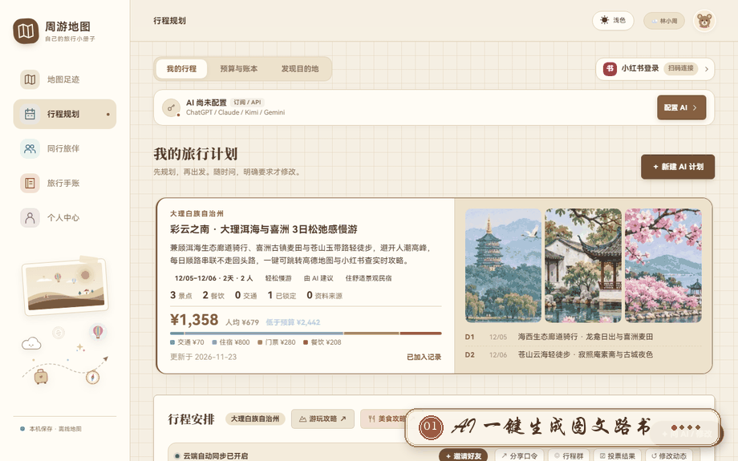
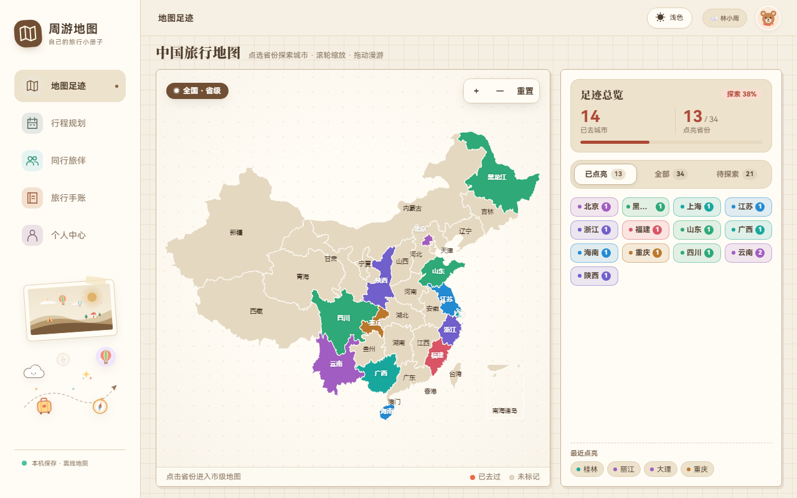

<div align="center">


# 周游地图 · Zhouyou Map

**一站式跨平台旅游集成工具 · AI 图文路书与备用方案 × 主流地图与小红书顺滑直连 × 好友共编与记账 × 足迹地图手账**

<p>
  <a href="README.md"><b>简体中文</b></a>
  &nbsp;·&nbsp;
  <a href="docs/README_EN.md">English</a>
</p>

<p>
  <a href="https://github.com/Eldonwyd/zhouyou-app/releases">
    
  </a>
  <a href="https://github.com/Eldonwyd/zhouyou-app/releases">
    
  </a>
  <a href="https://github.com/Eldonwyd/zhouyou-app/actions/workflows/ci.yml">
    
  </a>
  <a href="https://github.com/Eldonwyd/zhouyou-app/stargazers">
    
  </a>
  <a href="LICENSE">
    
  </a>
</p>

<p>
  
  
  
</p>

<p>
  <a href="https://zhouyou.online/?demo=1"><b>🚀 一键在线试玩</b></a>
  &nbsp;·&nbsp;
  <a href="https://zhouyou.online/download.html"><b>📥 官网下载中心</b></a>
  &nbsp;·&nbsp;
  <a href="#-核心亮点"><b>🌟 核心亮点</b></a>
  &nbsp;·&nbsp;
  <a href="#-界面精选"><b>🖼️ 界面精选</b></a>
  &nbsp;·&nbsp;
  <a href="#-电脑版下载"><b>💻 电脑版</b></a>
  &nbsp;·&nbsp;
  <a href="#-手机版下载"><b>📱 手机版</b></a>
</p>

<br />

<table>
  <tr>
    <td align="center" width="50%">
      
      <br /><b>🤖 一站式 AI 路书</b> — 图文介绍 · 备用方案 · 随时微调
    </td>
    <td align="center" width="50%">
      
      <br /><b>🤝 好友共编与记账</b> — 群聊投票改计划 · 记账自动分摊
    </td>
  </tr>
</table>

<p><sub>💡 第一次打开？直接点 <a href="https://zhouyou.online/?demo=1"><b>在线演示模式（?demo=1）</b></a>，免安装体验复古手账界面、14 座点亮城市、完整大理 AI 路书与照片手账，随时一键清空。</sub></p>

</div>

---

## 🌟 核心亮点

### 🤖 1. AI 一键生成完整行程 & 全周期管家 —— 图文介绍、备用计划、随时调整
- **1 分钟出完整图文路书**：输入目的地、日期/天数、同行人群（成人/学生/老人/儿童独立票价）与预算，AI 一键规划每日顺路行程，自带**景点详细介绍、4A/5A 景区等级、实景配图**（严格地名校验与质检过滤）、站间交通接驳、住宿建议与费用拆解。
- **自带备用计划，遇变化不抓瞎**：行程贴心预留**「备用玩法」与「未去热门景点」**，旅途中遇下雨、睡懒觉或临时改主意，轻点即可把备选景点安排进当天日程。
- **全程随时调整更改**：支持针对全局或单个景点**随时对话微调**，满意的站点一键**锁定防误改**，每次修改均支持撤销与历史版本回退。
- **行前省心闭环 & 多端同步**：自动汇总需预约景点与未购车次/航班进入**抢票计划**（开售前准点提醒 + 红点预警）；本地离线 **PP-OCRv5** 识别高铁/机票/酒店截图入账；内置出发日历、AI 行李清单与单文件离线 HTML 路书；登录周游账号即可在 **Windows / macOS / Linux / Android / iOS / Web PWA** 之间准实时同步，电脑做攻略、手机直接用。
- **零门槛 + 多模型自由切换**：内置登录即用的**周游免费体验 AI**、支持 **0 成本借用外部免费 AI 导入**，也原生支持 DeepSeek、OpenAI、Claude、Gemini、通义千问、智谱、Kimi 及主流订阅账号。

### 🔗 2. 顺滑切换常用旅行应用 —— 主流地图导航 × 小红书一键直连
- **一键唤起主流地图导航**：行程里的每一处景点、餐厅、住宿和未去热门景点，轻点即可直接唤起你偏好的主流地图 App（支持高德、百度、谷歌等自由切换），告别反复复制粘贴地名。
- **原生 App 顺滑衔接**：手机端优先直接拉起原生地图与小红书 App，未安装时自动平滑回落网页版，在行程、导航与攻略之间自然切换。
- **小红书双向联动**：粘贴小红书链接或攻略截图即可自动提取景点加入**「待选灵感池」**，直接叠加在路线地图上查看是否顺路；行程页与手账页内置分城市游玩/美食攻略入口，旅途中还能一键查实拍避坑与附近行李寄存。

### 🤝 3. 同行旅伴与好友协作 —— 一起看计划、一起改计划、一起轻松记账
- **一起看计划**：一键建群或将行程分享给同行伙伴（支持面对面建群、邀请码及微信/QQ 分享），大家随时同步查看同一份最新图文路书，不再翻聊天记录找最新版本。
- **一起改计划**：内置好友私聊与行程群聊（支持发图、推攻略卡、群发行前清单与提醒）；群成员可对景点点 **「👍 想去 / 🤔 备选 / ⏭ 跳过」** 投票批注，更可将 **AI 给出的备选方案一键发群投票，最高票出炉后点一下「执行」自动改好整份行程**并同步全员。
- **一起轻松记账**：旅途中谁垫付了民宿、包车或聚餐，在群里随手记一笔并勾选参与人，系统自动按整数分精度算出清晰的分摊与转账方案，返程几分钟就能结清全款。
- **好友足迹对比 & 亲密关系**：一键叠加双人中国足迹地图（「共同去过 / 对方去过 / 我去过 / 共同想去」），支持绑定情侣、家人、挚友、闺蜜亲密关系卡片与纪念日记录。

### 🗺️ 4. 中国足迹地图点亮、照片手账与旅途徽章 —— 把每次归来珍藏成册
- **全国 34 省 × 370+ 城市边界**：支持省级缩放下钻与智能标签避让，点击点亮 **「已去过 / 计划前往」** 并实时统计探索百分比；支持**按省一键缓存离线地图**，坐飞机高铁无网也能流畅看。
- **沉浸式照片语音手账**：按「某次旅行」或「某座城市」归档原图照片、短视频、文字随记与现场语音评语，自动读取 EXIF 拍摄时间线并校验 GPS 归属城市，每座点亮城市配备专属地标明信片与高光拍立得墙。
- **旅人成长徽章 & 个性化体验**：内置 8 阶旅人成长路线、9 枚预设成就、支持**手作专属圆形纪念章**并一键导出成就海报；默认采用温润耐看的**复古手账**风格（另含糖果贴纸、简洁纯白、海盐晴空、草木暖日共 5 套主题 + 深浅色），支持 **ZIP v3 一键全量备份与无损迁移**。

---

## 🖼️ 界面精选

<table>
  <tr>
    <td align="center" width="50%">
      
      <br /><b>🤖 AI 图文路书</b> — 景点介绍与实景配图、预算拆解与备用计划
    </td>
    <td align="center" width="50%">
      
      <br /><b>🤝 好友行程群</b> — 共享最新计划、群聊投票与旅途记账
    </td>
  </tr>
  <tr>
    <td align="center" width="50%">
      <picture>
        <source media="(prefers-color-scheme: dark)" srcset="docs/screenshots/desktop-map-dark.png" />
        <source media="(prefers-color-scheme: light)" srcset="docs/screenshots/desktop-map-light.png" />
        
      </picture>
      <br /><b>🗺️ 中国足迹地图</b> — 复古手账风，34 省 × 370+ 城下钻点亮
    </td>
    <td align="center" width="50%">
      
      <br /><b>📔 照片手账与明信片</b> — 原图、视频、现场语音与手作纪念章
    </td>
  </tr>
</table>

---

## 📥 下载与安装（电脑版与手机版独立下载）

电脑桌面版与手机移动版均为**完全独立的客户端**，登录周游账号即可自动同步攻略与足迹；优先推荐通过官方下载中心高速直下，同时保留 GitHub Releases 备用通道：

### 💻 电脑版下载

> 🔗 **电脑版官网下载页（推荐）**：[https://zhouyou.online/download-desktop.html](https://zhouyou.online/download-desktop.html)  
> 📦 **电脑版 GitHub Releases**：[https://github.com/Eldonwyd/zhouyou-app/releases?q=desktop](https://github.com/Eldonwyd/zhouyou-app/releases?q=desktop)

内置完整本地 AI 行程规划与离线 OCR 引擎，**无需安装 Node.js**，双击即用：

| 操作系统 | 适用设备 | 安装包格式 | 独立下载入口 |
| :--- | :--- | :--- | :---: |
| **Windows** | Windows 10 / 11 (x64) | 安装版 `.exe` / 绿色便携版 `.exe` | [](https://zhouyou.online/download-desktop.html) |
| **macOS** | Apple Silicon (M1–M4) & Intel | `.dmg` 镜像 | [](https://zhouyou.online/download-desktop.html) |
| **Linux** | Ubuntu / Debian / 通用发行版 (x64) | `.AppImage` / `.deb` | [](https://zhouyou.online/download-desktop.html) |

---

### 📱 手机版下载

> 🔗 **手机版官网下载页（推荐）**：[https://zhouyou.online/download-mobile.html](https://zhouyou.online/download-mobile.html)  
> 📦 **手机版 GitHub Releases**：[https://github.com/Eldonwyd/zhouyou-app/releases?q=mobile](https://github.com/Eldonwyd/zhouyou-app/releases?q=mobile)

电脑做攻略、手机直接带走，随时唤起常用地图与小红书、群聊投票改计划、旅途记账与记录原图手账：

| 平台 | 适用设备 | 安装方式与说明 | 独立下载入口 |
| :--- | :--- | :--- | :---: |
| **Android (安卓 · 推荐)** | Android 8.0+ 手机 / 平板 | 官网直下 `.apk`（原生唤起地图/小红书 & 免电脑直登 AI 订阅） | [](https://zhouyou.online/download-mobile.html) |
| **iOS (苹果手机)** | iPhone / iPad | `.ipa` 自签（AltStore / SideStore / TrollStore） | [](https://zhouyou.online/download-mobile.html) |
| **Web PWA** | Safari / Chrome / Edge / 系统浏览器 | **「添加到主屏幕」**（打开快、免安装、支持账号同步） | [](https://zhouyou.online/) |

<details>
<summary><b>📖 展开查看各系统安装贴士（Windows / macOS / Linux / Android / iOS）</b></summary>

- **Windows SmartScreen 提示**：点击 **「更多信息」→「仍要运行」** 即可。
- **macOS 提示“已损坏”或“无法验证开发者”**：拖入应用程序文件夹后，在终端执行：
  ```bash
  xattr -cr "/Applications/Zhouyou Map.app"
  ```
- **Linux AppImage / DEB**：
  ```bash
  chmod +x Zhouyou-Map-*-linux-*.AppImage && ./Zhouyou-Map-*-linux-*.AppImage
  # 或 Ubuntu / Debian：
  sudo apt install ./Zhouyou-Map-*-linux-*.deb
  ```
- **手机端快捷安装**：用手机浏览器或 Safari 打开 [https://zhouyou.online/](https://zhouyou.online/) → 点击菜单/分享按钮 → **「添加到主屏幕 / 添加到桌面」** 即可全屏使用、自动更新。
- **可选：手机端连接电脑 AI 服务**：在电脑桌面版顶部菜单「应用」勾选「允许局域网手机连接 AI 服务」，并将局域网地址填入手机端「个人中心 → 远程 / 局域网 AI 服务」即可互联。

详细图文说明请参阅 [全平台安装与使用指南 (docs/DOWNLOAD.md)](docs/DOWNLOAD.md)。

</details>

---

## 🤖 支持的 AI 服务商与本地能力

| 类别 | 支持项 | 说明 |
| :--- | :--- | :--- |
| **零门槛 AI 体验** | 周游免费体验 AI · 外部免费 AI 导入（DeepSeek / 豆包 / Kimi 网页版等） | 登录即可体验免费 AI，或 0 成本复制提示词借用任意外部 AI 生成并自动解析成结构化路书 |
| **API 密钥接入** | DeepSeek · OpenAI · Claude · Gemini · 通义千问 (Qwen) · 智谱 GLM · Kimi · 自定义兼容接口 | 按服务商独立保存密钥、模型与思考档位，自动适配联网检索 |
| **订阅账号登录** | ChatGPT · Claude · Kimi Code · Gemini CLI | 支持 OAuth 授权登录与动态拉取最新模型目录 |
| **本地离线 AI** | PP-OCRv5 Mobile (ONNX) · RT-DETR r18 (ONNX) | 本机离线识别高铁/机票/酒店截图入账，以及景点实景配图质检过滤 |

---

## 📁 目录结构

```text
zhouyou-app/
├── .github/          # CI/CD 自动构建发布工作流、Issue/PR 模板、贡献与安全规范
├── cloud-lib/        # 云端账号认证、增量同步与社交通用模块
├── data/places/      # 离线补充地点数据包
├── docs/             # 英文文档、更新日志、安装指南与界面预览图
├── electron/         # 桌面端主进程、预加载脚本、打包配置与品牌图标资源
├── functions/        # Cloudflare Pages 云函数（账号登录 / 多端同步 / 好友社交 / 行程群与聊天 / 分享）
├── migrations/       # Cloudflare D1 数据库迁移脚本
├── public/           # 中国省市 GeoJSON 地图、PWA Manifest、离线 SW 与官网下载页
├── scripts/          # 构建打包脚本、移动端原生配置脚本与端到端测试
├── server/           # 本地 Node.js AI 行程规划、联网检索与 ONNX OCR 服务
└── src/              # React 19 + TypeScript 前端核心（AI 规划 / 同行旅伴 / 足迹地图 / 照片手账 / 个人中心）
```

---

## 🛠️ 开发者快速开始

需要 **Node.js 22+**（推荐 Node.js 24 LTS）：

```bash
git clone https://github.com/Eldonwyd/zhouyou-app.git
cd zhouyou-app
npm install
npm run dev
```

常用打包与发版命令：

```bash
npm run desktop:dev     # 本地运行 Electron 桌面端
npm run desktop:win     # 打包 Windows (.exe 安装版 & 便携版)
npm run desktop:mac     # 打包 macOS (.dmg arm64 & x64)
npm run desktop:linux   # 打包 Linux (.AppImage & .deb)
npm run mobile:android  # 生成并同步 Android Capacitor 工程
npm run mobile:ios      # 生成并同步 iOS Capacitor 工程

# 触发 GitHub Actions 独立发布电脑版或手机版：
git tag desktop-v1.0.0 && git push origin desktop-v1.0.0
git tag mobile-v1.0.0  && git push origin mobile-v1.0.0
```

---

## 🤝 参与贡献与更新日志

- 欢迎提交 Issue 或 Pull Request！贡献前请阅读 [贡献指南 (.github/CONTRIBUTING.md)](.github/CONTRIBUTING.md) 与 [安全策略 (.github/SECURITY.md)](.github/SECURITY.md)。
- 版本变更记录见 [更新日志 (docs/CHANGELOG.md)](docs/CHANGELOG.md)。

## 📈 Star History

如果周游地图让你的旅行更省心、帮你点亮了地图与回忆，欢迎点亮右上角 **⭐ Star** 支持！

<a href="https://star-history.com/#Eldonwyd/zhouyou-app&Date">
  <picture>
    <source media="(prefers-color-scheme: dark)" srcset="https://api.star-history.com/svg?repos=Eldonwyd/zhouyou-app&type=Date&theme=dark" />
    <source media="(prefers-color-scheme: light)" srcset="https://api.star-history.com/svg?repos=Eldonwyd/zhouyou-app&type=Date&theme=light" />
    
  </picture>
</a>

---

## 💡 为什么用周游地图？（一个应用走完旅行全流程）

平时出门旅游，往往要在找攻略、排路线、群里讨论、切地图导航、记抢票、旅途记账和整理照片之间来回切换。**周游地图把整条旅行链路自然集成进同一个应用**：

| 传统切多个 App 的痛点 | 周游地图的一站式解法 |
| :--- | :--- |
| **大厂 AI 只给一段静态纯文本**，改一处全盘乱套、没有退路 | **结构化图文路书**：自带景点介绍、4A/5A 标识、实景配图、预算拆解与**备用计划**，支持单点锁定与随时对话微调 |
| **看攻略、查导航要反复复制地名切屏** | **顺滑切换外部应用**：一键直接唤起常用主流地图 App 导航与小红书，还能把小红书攻略解析进路线灵感池 |
| **微信群讨论 500 条定不下路线，返程记账分摊极易出错** | **一起看计划、一起改计划、一起轻松记账**：一键共享最新路书，支持**群聊投票 + AI 自动改计划**，旅途开销随手一记自动理清分摊明细 |
| **出发前忘抢票、车票订单分散难对账** | **行前省心闭环**：需预约景点与未购车次自动入**抢票计划提前提醒**，本地离线 **PP-OCRv5** 扫票入账，电脑做好手机多端同步 |
| **单一打卡地图 / 手账 App 低频吃灰** | **工具带动回忆沉淀**：归来顺手点亮全国 370+ 城地图、归档原图与现场语音明信片手账、手作专属徽章导出海报 |

---

## 📄 开源协议与数据说明

- 本项目基于 **[MIT License](LICENSE)** 开源。
- 地图边界文件位于 `public/maps/`（包含全国 34 个省级行政区边界），二次分发地理数据时请遵守 DataV 原始条款及适用合规要求。
- 在线路线地图瓦片默认使用 [OpenStreetMap](https://operations.osmfoundation.org/policies/tiles/)，可通过 `PLANNER_MAP_TILE_URL` 替换。
