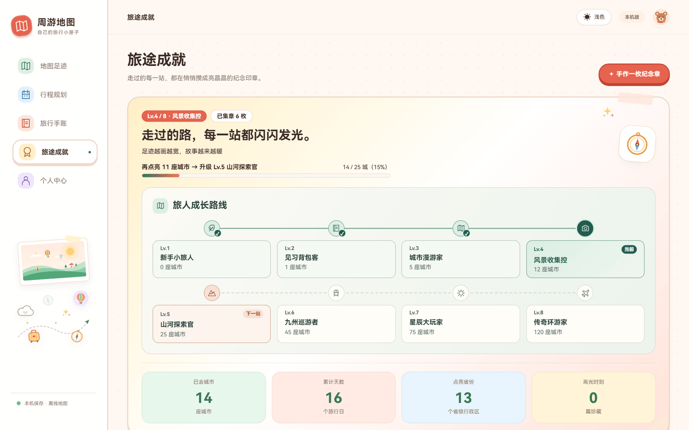
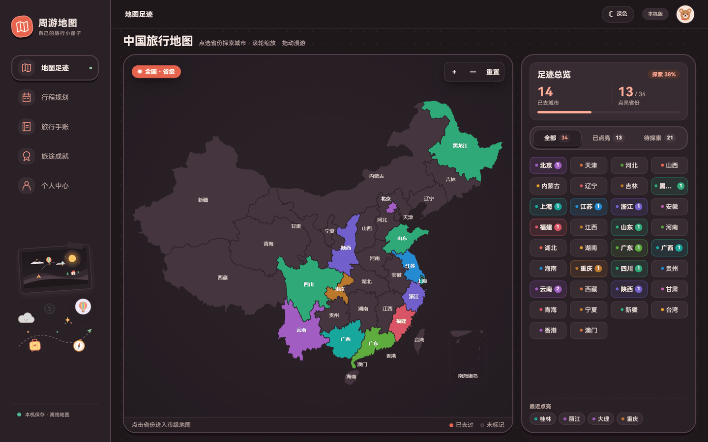
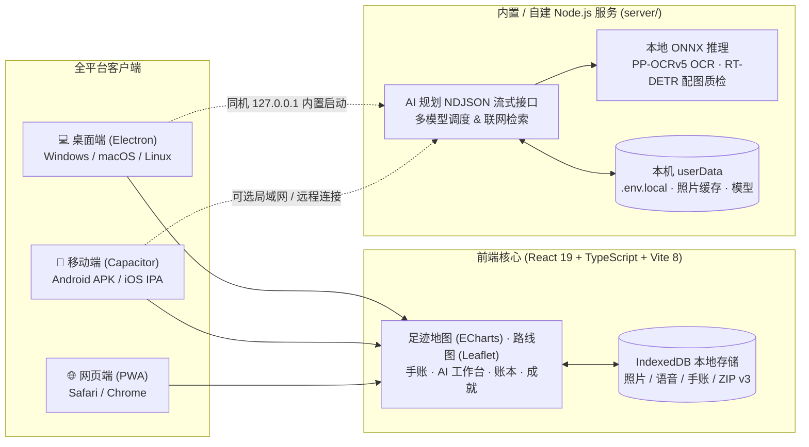

<div align="center">


# 周游地图 · Zhouyou Map

**一款隐私优先、跨平台、开箱即用的中国旅行足迹地图、手账与多模型 AI 行程规划器**

<p>
  <a href="README.md"><b>简体中文</b></a>
  &nbsp;·&nbsp;
  <a href="README_EN.md">English</a>
</p>

<p>
  <a href="https://github.com/Eldonwyd/zhouyou-app/releases/latest">
    
  </a>
  <a href="https://github.com/Eldonwyd/zhouyou-app/releases">
    
  </a>
  <a href="https://github.com/Eldonwyd/zhouyou-app/actions/workflows/ci.yml">
    
  </a>
  <a href="https://github.com/Eldonwyd/zhouyou-app/stargazers">
    
  </a>
  <a href="LICENSE">
    
  </a>
</p>

<p>
  
  
  
</p>

<p>
  <a href="#-电脑版下载"><b>💻 电脑版下载</b></a>
  &nbsp;·&nbsp;
  <a href="#-手机版下载"><b>📱 手机版下载</b></a>
  &nbsp;·&nbsp;
  <a href="https://eldonwyd.github.io/zhouyou-app/"><b>✨ 在线网页版 (PWA)</b></a>
  &nbsp;·&nbsp;
  <a href="#-界面预览"><b>🖼️ 界面预览</b></a>
  &nbsp;·&nbsp;
  <a href="#-开发者快速开始"><b>🛠️ 本地开发</b></a>
  &nbsp;·&nbsp;
  <a href="https://github.com/Eldonwyd/zhouyou-app/issues"><b>🐛 问题反馈</b></a>
</p>

<br />

<!-- 根据 GitHub 深浅色主题自动切换主图 -->
<picture>
  <source media="(prefers-color-scheme: dark)" srcset="docs/screenshots/desktop-map-dark.png" />
  <source media="(prefers-color-scheme: light)" srcset="docs/screenshots/desktop-map-light.png" />
  
</picture>

</div>

---

## ✨ 为什么选择周游地图？

市面上的旅行软件往往广告繁杂、强制云端登录、功能割裂。**周游地图**把「点亮足迹地图」「收藏旅行回忆」「AI 深度行程规划」「每日账本与 AA 分账」收进同一本温暖轻盈的旅行小册子：

- **🔒 本地隐私优先**：所有足迹、手账文字、原图照片、视频与语音都保存在你自己的设备本地（IndexedDB），无广告、无遥测、不强制注册账号，支持 **ZIP v3 一键全量备份与跨设备恢复**。
- **💻 桌面端开箱即用**：Windows / macOS / Linux 桌面安装包内置完整本地 Node.js AI 服务与离线 ONNX OCR 引擎，**无需安装 Node.js 或配置终端**，双击即可开启全部功能。
- **📱 全端覆盖**：原生支持 **Android (`.apk`)** 与 **iOS (`.ipa` + Safari PWA 一键添加)**，离线记录足迹与手账；在家同一 Wi-Fi 下还可一键连接电脑桌面版启用完整 AI 行程规划。
- **🎨 治愈系高颜值设计**：内置 **5 套视觉主题风格**（糖果贴纸 / 纯白极简 / 纸感手账 / 海风海岸 / 暖日手账）与 **浅色 / 深色 / 跟随系统** 模式，并配有多套中国城市地标明信片插画。

---

## 📥 下载与安装（电脑版与手机版独立下载）

电脑桌面版与手机移动版均为**完全独立的客户端**，拥有各自独立的下载专区与 GitHub Release 发布通道，按需选择对应入口即可：

### 💻 电脑版下载

> 🔗 **电脑版独立下载页**：[https://eldonwyd.github.io/zhouyou-app/download-desktop.html](https://eldonwyd.github.io/zhouyou-app/download-desktop.html)  
> 📦 **电脑版 GitHub Releases**：[https://github.com/Eldonwyd/zhouyou-app/releases?q=desktop-v](https://github.com/Eldonwyd/zhouyou-app/releases?q=desktop-v)

内置完整本地 AI 行程规划与离线 OCR 引擎，**无需安装 Node.js**，双击即用：

| 操作系统 | 架构 / 发行版 | 安装包格式 | 独立下载入口 |
| :--- | :--- | :--- | :---: |
| **Windows** | Windows 10 / 11 (x64) | 安装版 `.exe` / 绿色便携版 `.exe` | [](https://github.com/Eldonwyd/zhouyou-app/releases?q=desktop-v) |
| **macOS** | Apple Silicon (M1–M4) & Intel | `.dmg` 镜像 | [](https://github.com/Eldonwyd/zhouyou-app/releases?q=desktop-v) |
| **Linux** | Ubuntu / Debian / 通用发行版 (x64) | `.AppImage` / `.deb` | [](https://github.com/Eldonwyd/zhouyou-app/releases?q=desktop-v) |

---

### 📱 手机版下载

> 🔗 **手机版独立下载页**：[https://eldonwyd.github.io/zhouyou-app/download-mobile.html](https://eldonwyd.github.io/zhouyou-app/download-mobile.html)  
> 📦 **手机版 GitHub Releases**：[https://github.com/Eldonwyd/zhouyou-app/releases?q=mobile-v](https://github.com/Eldonwyd/zhouyou-app/releases?q=mobile-v)

独立安装与离线使用中国足迹地图、旅行手账（照片/视频/语音）、每日账本、旅途成就与 ZIP 备份：

| 平台 | 适用设备 | 安装方式 | 独立下载入口 |
| :--- | :--- | :--- | :---: |
| **Android (安卓)** | Android 8.0+ 手机 / 平板 | 直接安装 `.apk` | [](https://github.com/Eldonwyd/zhouyou-app/releases?q=mobile-v) |
| **iOS (苹果手机)** | iPhone / iPad | `.ipa` 自签（AltStore / SideStore / TrollStore / Sideloadly） | [](https://github.com/Eldonwyd/zhouyou-app/releases?q=mobile-v) |
| **iOS / 手机免安装** | Safari / Chrome 浏览器 | PWA「添加到主屏幕」（免自签、永不掉签） | [](https://eldonwyd.github.io/zhouyou-app/) |

<details>
<summary><b>📖 展开查看各系统安装贴士（macOS 已损坏修复 / iOS 免自签 / 手机连接电脑 AI）</b></summary>

- **Windows SmartScreen 提示**：开源软件暂未购买 EV 代码签名证书，若弹出安全提示，点击 **「更多信息」→「仍要运行」** 即可。
- **macOS 提示“已损坏”或“无法验证开发者”**：拖入应用程序文件夹后，在终端执行以下命令即可正常启动：
  ```bash
  xattr -cr "/Applications/Zhouyou Map.app"
  ```
- **Linux AppImage / DEB**：
  ```bash
  # AppImage
  chmod +x Zhouyou-Map-*-linux-*.AppImage && ./Zhouyou-Map-*-linux-*.AppImage
  # Ubuntu / Debian
  sudo apt install ./Zhouyou-Map-*-linux-*.deb
  ```
- **iPhone 免自签一键安装（推荐）**：用系统自带 **Safari** 打开 [在线网页版](https://eldonwyd.github.io/zhouyou-app/) → 点击底部分享按钮 → **「添加到主屏幕」**，即可获得全屏 App 体验并支持离线记录。
- **手机端如何启用 AI 行程规划**：打开电脑桌面版 → 顶部菜单 **「应用」→ 勾选「允许局域网手机连接 AI 服务」** → 在手机端 **「个人中心 → 远程 / 局域网 AI 服务」** 填入电脑局域网地址即可互联！

更多详细步骤请参阅 [完整安装与故障排查指南 (docs/DOWNLOAD.md)](docs/DOWNLOAD.md)。

</details>

---

## 🖼️ 界面预览

<table>
  <tr>
    <td align="center" width="50%">
      
      <br /><sub><b>🤖 多模型 AI 行程规划</b> · 支持思考档位、联网检索与票据导入</sub>
    </td>
    <td align="center" width="50%">
      
      <br /><sub><b>📔 旅行手账与城市明信片</b> · 按行程与城市珍藏图文、语音与视频</sub>
    </td>
  </tr>
  <tr>
    <td align="center" width="50%">
      
      <br /><sub><b>🏆 旅途成就与八阶成长路线</b> · 记录点亮进度、手作纪念章与海报导出</sub>
    </td>
    <td align="center" width="50%">
      
      <br /><sub><b>🌙 护眼深色主题</b> · 5 套风格 × 浅色/深色/跟随系统自由切换</sub>
    </td>
  </tr>
</table>

<div align="center">
  <h4>📱 移动端原生适配（Android / iOS / PWA）</h4>
  <p>
    
    &nbsp;&nbsp;&nbsp;&nbsp;
    
  </p>
</div>

---

## 🧭 核心功能一览

| 模块 | 亮点特性 |
| :--- | :--- |
| **🗺️ 中国足迹地图** | 覆盖全国 **34 个省级行政区与地级市边界**；智能标签避让与双指/滚轮缩放；区分「已去过」与「计划前往」；支持按省缓存离线地图，断网也能流畅浏览。 |
| **📔 旅行手账与媒体库** | 按行程（起止日期、同行人）或城市整理回忆；支持多段文字便签、原图照片、视频与 **现场语音录制**；自动读取照片拍摄时间与 GPS 坐标校验城市归属。 |
| **🤖 AI 行程规划工作台** | 支持季节目的地推荐、多类出行人群（成人/学生/老人/儿童独立票价）、锁定活动与版本撤回、交互式 Leaflet 路线地图、站间交通接驳对比、门票预约提醒与 **AI 行李清单**。 |
| **🧾 票据 OCR 与离线路书** | 内置 **本地离线 PP-OCRv5 (ONNX)** 识别高铁/机票/酒店订单截图，图片不上传第三方 OCR；支持日历 `.ics` 提醒与 **单文件自包含离线 HTML 路书**导出（内嵌图片，方便打印与无网查看）。 |
| **💰 每日账本与 AA 分账** | 按早餐/午餐/晚餐/交通/门票/住宿/其他逐日记账；AI 预算自动预填且不覆盖手动修改；内置 **整数分精确 AA 分账结算**，同行聚餐出游算账零误差。 |
| **🏆 旅途成就系统** | 8 阶旅人成长路线（新手小旅人 → 传奇环游家）、自动与自定义手作纪念章、一键导出高清旅行成就分享海报。 |
| **📦 数据备份与迁移** | 全量 **ZIP v3 备份**（含足迹、手账、照片视频录音、AI 计划及配图、账本与个人名片），向下兼容旧版备份，换机/换浏览器一键无损迁移。 |

---

## 🤖 支持的 AI 服务商与本地能力

所有 AI 密钥均仅保存在用户本机配置目录，可在应用内图形化界面随时添加与一键切换：

| 类别 | 支持项 | 说明 |
| :--- | :--- | :--- |
| **API 密钥接入** | **DeepSeek**、**OpenAI**、**Anthropic Claude**、**Google Gemini**、**通义千问 (Qwen)**、**智谱 GLM**、**Kimi**、**自定义 OpenAI 兼容接口** | 支持按服务商独立保存密钥、模型与思考深度档位；自动适配内置联网检索 |
| **订阅账号登录** | **ChatGPT**、**Claude**、**Kimi Code**、**Gemini CLI** | 支持 OAuth 浏览器授权与动态拉取最新可用模型目录 |
| **本地离线 AI** | **PP-OCRv5 Mobile (ONNX)**、**RT-DETR r18 (ONNX)** | 本地识别票据截图文字、本地质检配图（过滤带大字/拼图/人像封面），首次按需下载并校验 SHA-256 |
| **地图与图片来源** | OpenStreetMap / 高德 Web 服务（可选）、Wikimedia Commons、小红书公开源 / 本地可选桥接、Brave Images（可选） | 保留所有参考来源链接与查询日期，未核实价格明确标示为预估 |

---

## 🏗️ 系统架构



---

## 🛠️ 开发者快速开始

### 环境要求

- **Node.js** `>= 22.0.0`（推荐 **Node.js 24+**）
- **npm** `>= 10`

### 1. 克隆并启动网页开发版

```bash
git clone https://github.com/Eldonwyd/zhouyou-app.git
cd zhouyou-app
npm install
npm run dev
```

打开终端输出的地址（默认 `http://127.0.0.1:5173`），网页与本地 AI 规划服务在同一端口启动。

- 局域网手机实时调试：`npm run dev:phone`
- 生产构建并启动：`npm run build && npm start`（默认端口 `4173`）
- 环境变量配置：复制 `.env.example` 为 `.env.local`（或直接在页面内「AI 配置」中可视化填写）

### 2. 本地打包桌面端与移动端

```bash
# 桌面端 Electron 本地开发启动
npm run desktop:dev

# 打包桌面端安装包（输出至 release/ 目录）
npm run desktop:win     # Windows (.exe 安装版 + 便携版)
npm run desktop:mac     # macOS (.dmg arm64 + x64，需在 macOS 下执行)
npm run desktop:linux   # Linux (.AppImage + .deb，需在 Linux 下执行)

# 准备移动端 Capacitor 原生工程
npm run mobile:android  # 生成并同步 android/ 工程，可用 Android Studio / Gradle 构建 APK
npm run mobile:ios      # 生成并同步 ios/ 工程，可用 Xcode 构建 IPA
```

### 3. 一键触发 GitHub Actions 独立发版（电脑版 / 手机版分别发布）

本仓库内置独立的桌面端与移动端 CI/CD 流水线（[`.github/workflows/release-desktop.yml`](.github/workflows/release-desktop.yml) 与 [`.github/workflows/release-mobile.yml`](.github/workflows/release-mobile.yml)）：

```bash
# 仅构建并发布电脑桌面版（Windows / macOS / Linux）
git tag desktop-v1.0.0
git push origin desktop-v1.0.0

# 仅构建并发布手机移动版（Android APK / iOS IPA）
git tag mobile-v1.0.0
git push origin mobile-v1.0.0
```

推送标签后（或在 GitHub 仓库 **Actions** 页面手动点击 **Run workflow**），GitHub Actions 将分别构建并发布独立的电脑版 / 手机版 GitHub Release，自动附带 `SHA256SUMS.txt`！

<details>
<summary><b>⚙️ 可选：配置 Android 持久化发布签名（推荐正式发版使用）</b></summary>

未配置 Secret 时，CI 会自动生成临时签名证书使 APK 可直接安装；如需后续升级覆盖安装不冲突，可在仓库 **Settings → Secrets and variables → Actions** 中添加：

- `ANDROID_KEYSTORE_BASE64`：`.jks` / `.keystore` 文件的 Base64 编码
- `ANDROID_KEYSTORE_PASSWORD`：Keystore 密码
- `ANDROID_KEY_ALIAS`：密钥别名
- `ANDROID_KEY_PASSWORD`：密钥密码

</details>

---

## 🗺️ 路线图

- [x] 中国 34 省级与地级市足迹地图、离线区域缓存
- [x] 旅行手账、城市明信片、照片/视频/语音媒体库与 ZIP v3 备份
- [x] 多模型 AI 行程规划、本地 PP-OCRv5 截图识图、每日账本与 AA 分账
- [x] Windows / macOS / Linux 桌面客户端（Electron）与 Android / iOS / PWA 移动端支持
- [x] GitHub Actions 全平台自动编译发布与 GitHub Pages 下载门户
- [ ] 世界地图与海外旅行足迹支持
- [ ] 可选 WebDAV / S3 端到端加密云同步
- [ ] 更多旅行海报模板与年度足迹总结报告

---

## 🤝 参与贡献

欢迎任何形式的贡献——提交 Bug 反馈、功能建议、代码 PR 或分享你的主题配色！请先阅读 [贡献指南 (CONTRIBUTING.md)](CONTRIBUTING.md)。

---

## 📈 Star History

如果这个项目帮你记录了珍贵的旅途回忆，欢迎点亮右上角的 **⭐ Star** 支持作者！

<a href="https://star-history.com/#Eldonwyd/zhouyou-app&Date">
  <picture>
    <source media="(prefers-color-scheme: dark)" srcset="https://api.star-history.com/svg?repos=Eldonwyd/zhouyou-app&type=Date&theme=dark" />
    <source media="(prefers-color-scheme: light)" srcset="https://api.star-history.com/svg?repos=Eldonwyd/zhouyou-app&type=Date" />
    
  </picture>
</a>

---

## 📄 开源协议与数据说明

- 本项目基于 **[MIT License](LICENSE)** 开源。
- 地图边界文件位于 `public/maps/`（包含全国 34 个省级行政区边界数据），如需二次分发地理边界数据，请留意 DataV 原始数据条款及适用的地图出版合规要求。
- 本项目的在线地图瓦片默认使用 [OpenStreetMap](https://operations.osmfoundation.org/policies/tiles/)，可通过 `PLANNER_MAP_TILE_URL` 切换兼容瓦片源。
