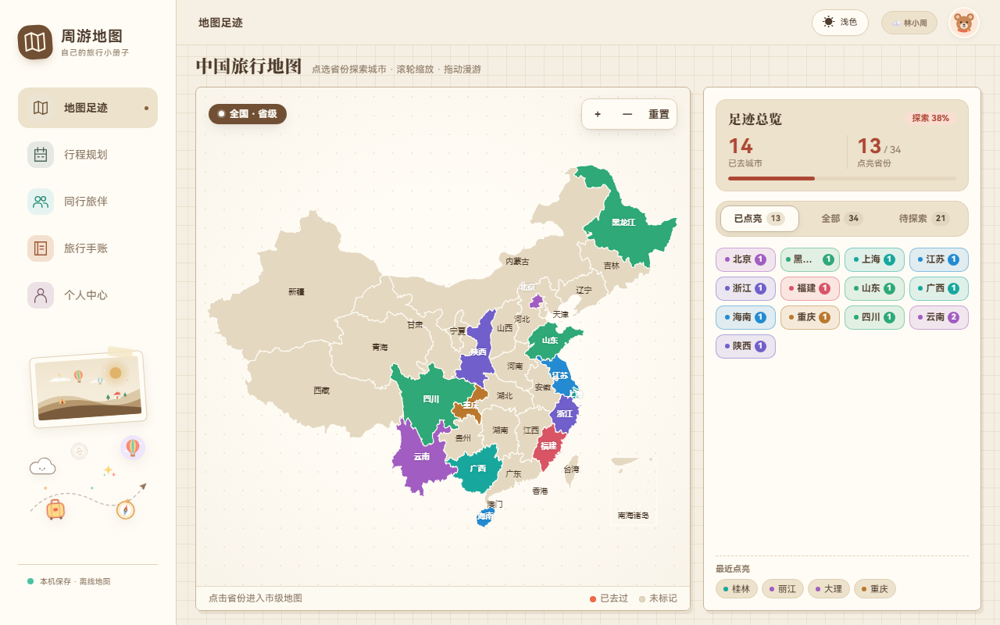
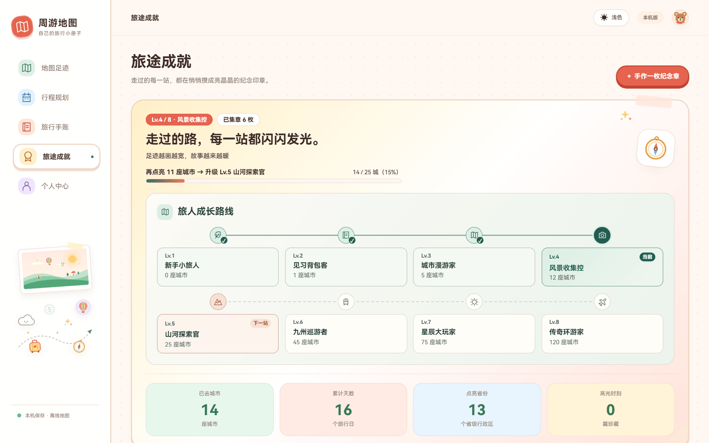
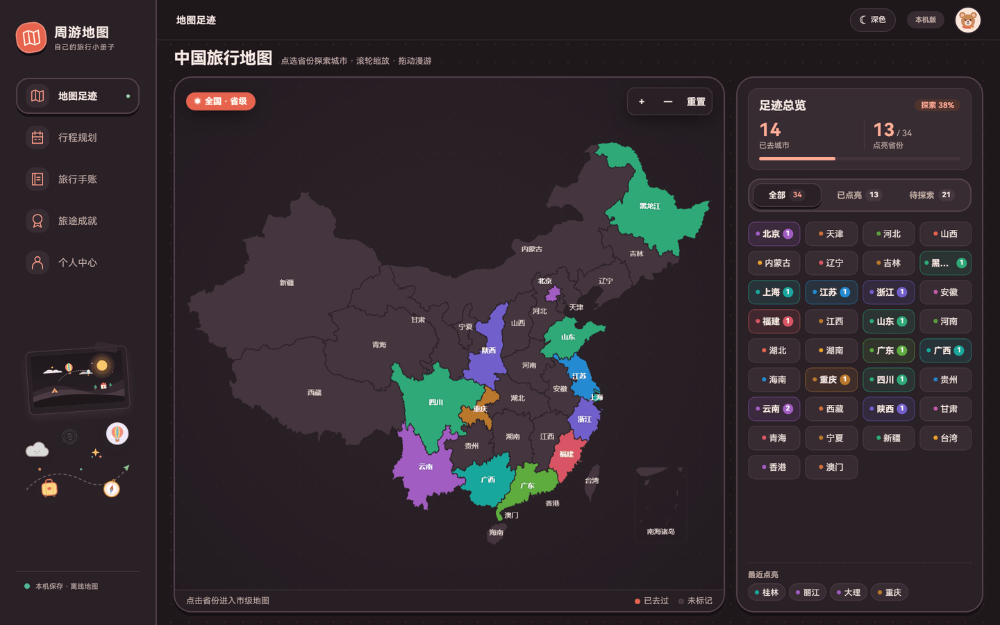
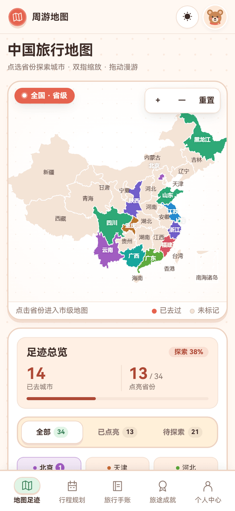
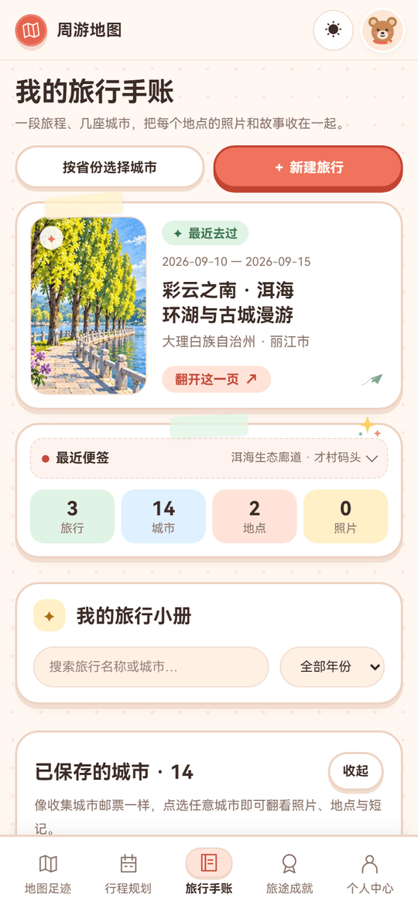

<div align="center">


# Zhouyou Map · 周游地图

**A local-first, cross-platform China travel footprint map, journal, ledger, and multi-model AI itinerary planner.**

<p>
  <a href="README.md">简体中文</a>
  &nbsp;·&nbsp;
  <a href="README_EN.md"><b>English</b></a>
</p>

<p>
  <a href="https://github.com/Eldonwyd/zhouyou-app/releases/latest">
    
  </a>
  <a href="https://github.com/Eldonwyd/zhouyou-app/releases">
    
  </a>
  <a href="https://github.com/Eldonwyd/zhouyou-app/actions/workflows/ci.yml">
    
  </a>
  <a href="https://github.com/Eldonwyd/zhouyou-app/stargazers">
    
  </a>
  <a href="LICENSE">
    
  </a>
</p>

<p>
  
  
  
</p>

<p>
  <a href="#-download"><b>📥 Download</b></a>
  &nbsp;·&nbsp;
  <a href="https://eldonwyd.github.io/zhouyou-app/download.html"><b>🌐 Download Portal</b></a>
  &nbsp;·&nbsp;
  <a href="https://eldonwyd.github.io/zhouyou-app/"><b>✨ Live Web / PWA</b></a>
  &nbsp;·&nbsp;
  <a href="#-screenshots"><b>🖼️ Screenshots</b></a>
  &nbsp;·&nbsp;
  <a href="#-development"><b>🛠️ Development</b></a>
</p>

<br />

<picture>
  <source media="(prefers-color-scheme: dark)" srcset="docs/screenshots/desktop-map-dark.png" />
  <source media="(prefers-color-scheme: light)" srcset="docs/screenshots/desktop-map-light.png" />
  
</picture>

</div>

---

## ✨ Highlights

> Note: The in-app UI is currently crafted in Chinese (`zh-CN`).

- **🔒 Privacy-First & Local-First**: All visited cities, journal notes, photos, videos, voice memos, and trip ledgers live inside local device storage (`IndexedDB`). Zero tracking, zero forced cloud account, with full **ZIP v3 backup & cross-device restore**.
- **💻 Ready-to-Use Desktop Apps**: Windows, macOS, and Linux desktop packages bundle both the React frontend and the local Node.js AI & ONNX OCR engine — double-click to launch with zero Node.js setup.
- **📱 Native Mobile & PWA**: Ships **Android (`.apk`)**, **iOS (`.ipa` for AltStore / SideStore / TrollStore / Sideloadly)**, and an instant **Web PWA** (1-tap *Add to Home Screen* in iOS Safari). Mobile apps work 100% offline for maps/journals and can connect to your Desktop app over LAN for full AI planning!
- **🤖 Multi-Provider AI & Offline OCR**: Works with DeepSeek, OpenAI, Claude, Gemini, Qwen, Zhipu, Kimi, custom OpenAI-compatible endpoints, plus local **PP-OCRv5** booking screenshot parsing and **RT-DETR** photo screening.

---

## 📥 Download (Separate Desktop & Mobile Releases)

Desktop and Mobile clients are packaged and released independently so you can download only what you need:

### 💻 Desktop App — [Desktop Download Page](https://eldonwyd.github.io/zhouyou-app/download-desktop.html) · [Desktop Releases](https://github.com/Eldonwyd/zhouyou-app/releases?q=desktop-v)

| Platform | Target / Format | Download |
| :--- | :--- | :---: |
| **Windows** | Windows 10/11 x64 (`.exe` Installer & Portable) | [](https://github.com/Eldonwyd/zhouyou-app/releases?q=desktop-v) |
| **macOS** | Apple Silicon (`arm64`) & Intel (`x64`) `.dmg` | [](https://github.com/Eldonwyd/zhouyou-app/releases?q=desktop-v) |
| **Linux** | x64 `.AppImage` & Debian/Ubuntu `.deb` | [](https://github.com/Eldonwyd/zhouyou-app/releases?q=desktop-v) |

### 📱 Mobile App — [Mobile Download Page](https://eldonwyd.github.io/zhouyou-app/download-mobile.html) · [Mobile Releases](https://github.com/Eldonwyd/zhouyou-app/releases?q=mobile-v)

| Platform | Target / Format | Download |
| :--- | :--- | :---: |
| **Android** | Android 8.0+ signed `.apk` | [](https://github.com/Eldonwyd/zhouyou-app/releases?q=mobile-v) |
| **iOS** | Unsigned `.ipa` (AltStore / SideStore / TrollStore) | [](https://github.com/Eldonwyd/zhouyou-app/releases?q=mobile-v) |
| **Web / PWA** | Instant browser & iOS Safari *Add to Home Screen* | [](https://eldonwyd.github.io/zhouyou-app/) |

See [docs/DOWNLOAD.md](docs/DOWNLOAD.md) for platform tips (macOS Gatekeeper `xattr -cr`, Windows SmartScreen, iOS sideloading, and Desktop-to-Mobile LAN AI pairing).

---

## 🖼️ Screenshots

<table>
  <tr>
    <td align="center" width="50%">
      
      <br /><sub><b>AI Itinerary Planner</b> · Multi-model, web search & OCR import</sub>
    </td>
    <td align="center" width="50%">
      
      <br /><sub><b>Travel Journal</b> · Postcards, memories, photos & voice notes</sub>
    </td>
  </tr>
  <tr>
    <td align="center" width="50%">
      
      <br /><sub><b>Traveler Roadmap & Badges</b> · 8 milestones & shareable posters</sub>
    </td>
    <td align="center" width="50%">
      
      <br /><sub><b>Dark Mode & 5 Themes</b> · Light, dark, and system themes</sub>
    </td>
  </tr>
</table>

<div align="center">
  
  &nbsp;&nbsp;&nbsp;&nbsp;
  
</div>

---

## 🛠️ Development

Requires **Node.js 22+** (Node.js 24 recommended).

```bash
git clone https://github.com/Eldonwyd/zhouyou-app.git
cd zhouyou-app
npm install

# Run Web Dev Server (frontend + planner API on port 5173)
npm run dev

# Run Electron Desktop App locally
npm run desktop:dev

# Package Desktop Installers (outputs to release/)
npm run desktop:win     # Windows (.exe)
npm run desktop:mac     # macOS (.dmg)
npm run desktop:linux   # Linux (.AppImage & .deb)

# Prepare Capacitor Mobile Projects
npm run mobile:android
npm run mobile:ios
```

### Automated Multi-Platform Release

Push a semantic version tag (or run the `Build & Release Multi-Platform Apps` workflow manually in GitHub Actions):

```bash
git tag v1.0.0
git push origin v1.0.0
```

GitHub Actions automatically builds **Windows, macOS, Linux, Android, and iOS** artifacts and publishes them to GitHub Releases with `SHA256SUMS.txt`.

---

## 📄 License

Distributed under the [MIT License](LICENSE). See `public/maps/` data notice before redistributing geographic boundary files.
