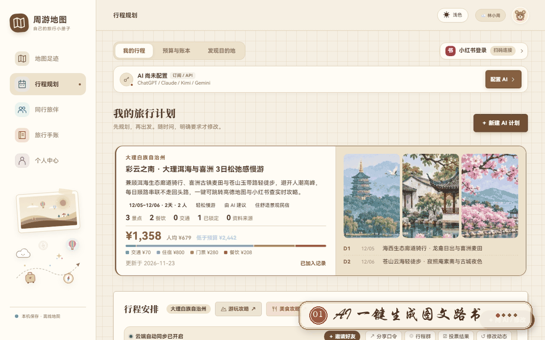
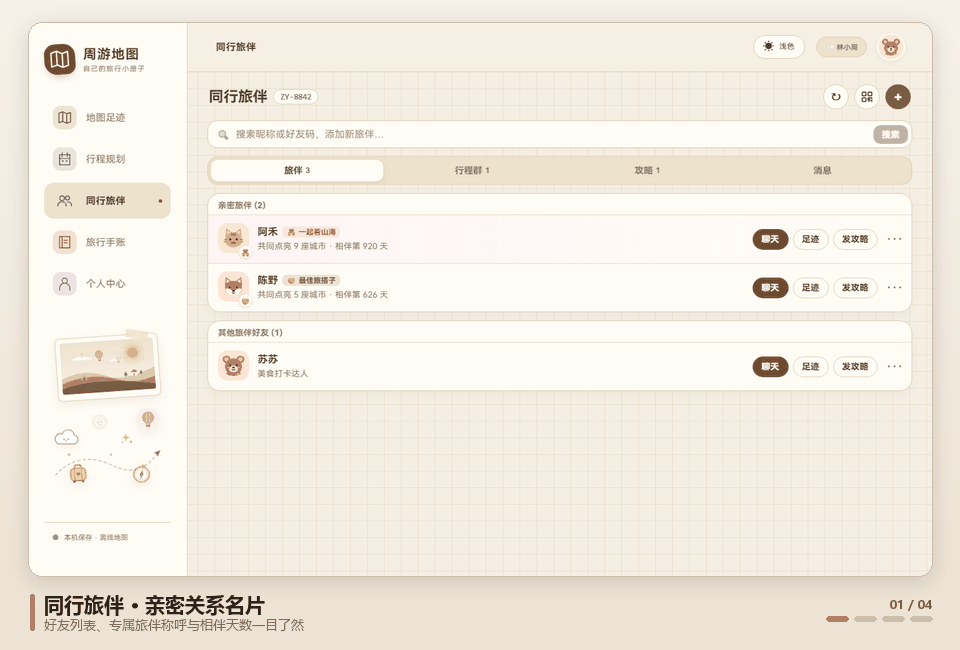
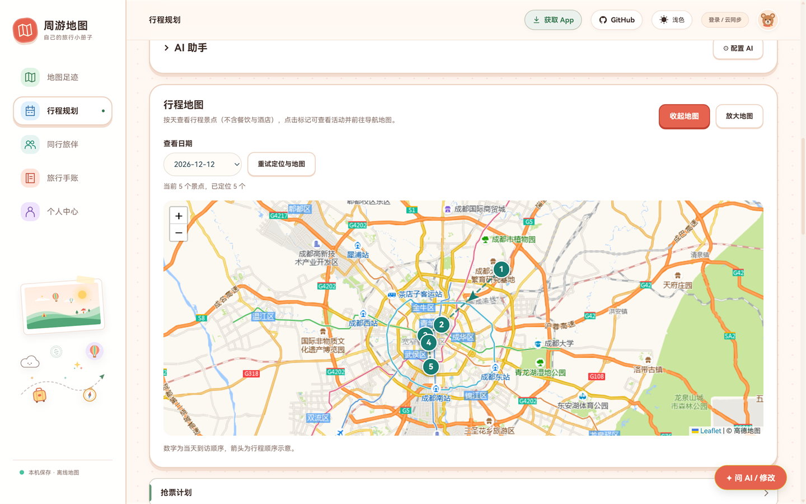
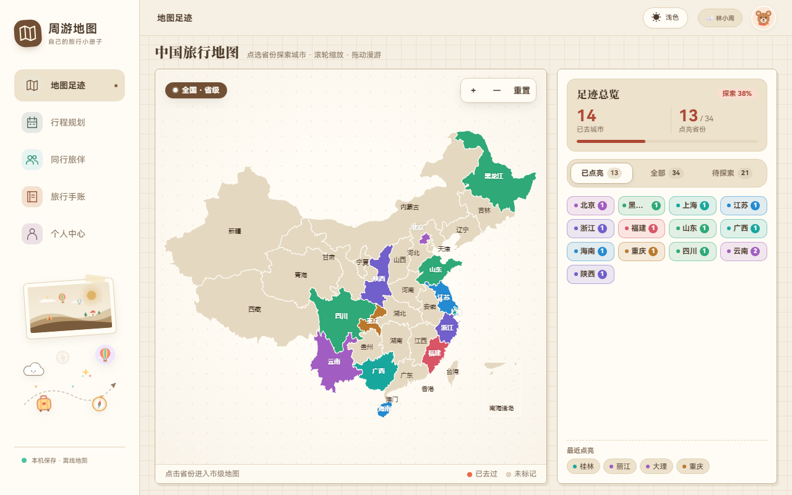
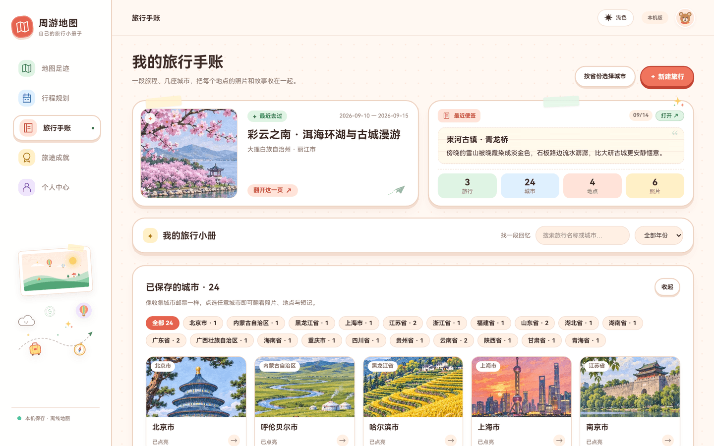

# Zhouyou Map · 周游地图

**An All-in-One Cross-Platform Travel Toolkit — AI Illustrated Roadbooks & Backup Plans × Smooth Map & Xiaohongshu Switching × Friend Co-Editing & Expense Tracking × Footprint Map & Photo Journals**

  <a href="../README.md">简体中文</a>
  &nbsp;·&nbsp;
  <a href="README_EN.md"><b>English</b></a>

  
  
  
  

  <a href="https://zhouyou.online/?demo=1"><b>🚀 Live Interactive Demo</b></a>
  &nbsp;·&nbsp;
  <a href="https://zhouyou.online/download.html"><b>📥 Download Center</b></a>
  &nbsp;·&nbsp;
  <a href="#-desktop-download"><b>💻 Desktop Download</b></a>
  &nbsp;·&nbsp;
  <a href="#-mobile-download"><b>📱 Mobile Download</b></a>
  &nbsp;·&nbsp;
  <a href="#-screenshots"><b>🖼️ Screenshots</b></a>

 

<table>
  <tr>
    <td align="center" width="50%">
      
       <b>🤖 All-in-One AI Roadbooks</b> — Illustrated Plans · Backups · Live Tweaks
    </td>
    <td align="center" width="50%">
      
       <b>🤝 Friends &amp; Expense Ledger</b> — Group Polls · Auto Bill Split
    </td>
  </tr>
</table>

---

## 🌟 Core Features

> Note: The in-app UI supports Chinese (`zh-CN`) and English (`en`), defaulting to the warm **Vintage Journal** paper aesthetic.

- **🤖 1. One-Click AI Roadbooks & All-in-One Trip Manager**: Generate complete day-by-day itineraries with place introductions, 4A/5A badges, real photos, transit connectors, and per-group budgets in one minute. Built-in backup plans & unvisited hotspots, spot locking, live conversational adjustments, ticket booking countdown reminders, and local PP-OCRv5 ticket screenshot import. Includes daily & monthly free AI quotas on sign-in, supports custom API keys and importing ChatGPT / Claude / Gemini subscriptions, plus one-click prompt export to craft itineraries with any external AI, synced across Windows, macOS, Linux, Android, iOS, and Web.
- **🔗 2. Smooth App Switching — Popular Map Apps × Xiaohongshu**: Freely switch between major map apps with native mobile launch and automatic web fallback. Parse Xiaohongshu links or screenshots straight into your map inspiration pool, and jump to live Xiaohongshu tips or luggage storage searches in one tap.
- **🤝 3. Travel Companions — View, Edit & Split Bills Together**: Create groups or share itineraries so everyone views the latest plan. Chat in-app, push AI-generated alternative plans to a group poll and execute the winning option automatically, log shared expenses for effortless bill splitting, and compare China footprint maps side-by-side.
- **🗺️ 4. China Footprint Map, Photo Journals & Travel Badges**: Light up visited and planned cities across all 34 provincial regions and 370+ cities with offline province map caching; archive original photos, videos, text notes, and voice memos with EXIF/GPS checks and illustrated city postcards; unlock 8 traveler tiers, craft custom round badges, export posters, and back up everything via **ZIP v3**.

---

## 🖼️ Screenshots

<table>
  <tr>
    <td align="center" valign="top" width="50%">
      
       <b>🤖 AI Illustrated Roadbook</b> — real photos, transit comparison, budgets &amp; backups
    </td>
    <td align="center" valign="top" width="50%">
      
       <b>🧭 Daily Sequential Route Map</b> — numbered stops, arrows &amp; one-tap navigation
    </td>
  </tr>
  <tr>
    <td align="center" valign="top" width="50%">
      <picture>
        <source media="(prefers-color-scheme: dark)" srcset="screenshots/desktop-map-dark.png" />
        <source media="(prefers-color-scheme: light)" srcset="screenshots/desktop-map-light.png" />
        
      </picture>
       <b>🗺️ China Footprint Map</b> — 34 provinces × 370+ cities
    </td>
    <td align="center" valign="top" width="50%">
      
       <b>📔 Photo Journal &amp; Postcards</b> — photos, voice &amp; badges
    </td>
  </tr>
</table>

---

## 📥 Download (Official Portal & Independent Releases)

### 💻 Desktop Download — [Official Portal](https://zhouyou.online/download-desktop.html) · [GitHub Releases](https://github.com/Eldonwyd/zhouyou-app/releases?q=desktop)

| Platform | Target / Format | Download |
| :--- | :--- | :---: |
| **Windows** | Windows 10/11 x64 (`.exe` Installer & Portable) |  |
| **macOS** | Apple Silicon (`arm64`) & Intel (`x64`) `.dmg` |  |
| **Linux** | x64 `.AppImage` & Debian/Ubuntu `.deb` |  |

### 📱 Mobile Download — [Official Portal](https://zhouyou.online/download-mobile.html) · [GitHub Releases](https://github.com/Eldonwyd/zhouyou-app/releases?q=mobile)

| Platform | Target / Format | Download |
| :--- | :--- | :---: |
| **Android (Recommended)** | Android 8.0+ signed `.apk` (native app switching & direct AI sub login) |  |
| **iOS** | Unsigned `.ipa` (AltStore / SideStore / TrollStore) |  |
| **Web / PWA** | Android / iOS *Add to Home Screen* |  |

See [DOWNLOAD.md](DOWNLOAD.md) for installation tips and [CHANGELOG.md](CHANGELOG.md) for release history.

---

## 📄 License

Distributed under the [MIT License](../LICENSE).
